# ⚡ DataVortex — Akıllı Excel Veri Bilimi, Analitik, Validasyon & 1-Tık AutoML Platformu

[](https://www.python.org/)
[](https://streamlit.io/)
[](https://scikit-learn.org/)
[](https://plotly.com/)
[](https://pandas.pydata.org/)
[](#)
[](#)

**DataVortex**, işletmeler, veri analistleri, araştırmacılar ve veri bilimciler için geliştirilmiş, uçtan uca modern ve interaktif bir **Excel & CSV Veri Bilimi, Akıllı Kodlama/Ayraç Tespiti, Güvenli Validasyon Mimarisi, Keşifçi Veri Analizi (EDA), 1-Tık Otomatik Makine Öğrenmesi (AutoML) ve Canlı Tahmin Simülatörü** platformudur.

Kod yazmaya gerek kalmadan Excel (.xlsx, .xls, .xlsm) veya CSV (.csv, .tsv, .txt) tablolarınızı yükleyebilir; otomatik kodlama (UTF-8, CP1254, ISO-8859-9) ve ayraç (virgül, noktalı virgül, tab) tespitiyle sıfır hata garantisiyle verinizi işleyebilirsiniz.

---

## 🏗️ Mimari ve Katman Yapısı

```mermaid
flowchart TD
    App["Thin Bootstrap Root (app.py)"] --> UI_Pages["UI Feature Pages (datavortex/ui/pages/)"]
    UI_Pages --> Explorer["1. Veri Gezgini (explorer.py)"]
    UI_Pages --> Cleaning["2. Veri Temizleme & Undo (cleaning.py)"]
    UI_Pages --> EDA["3. Keşifçi Analiz EDA (eda.py)"]
    UI_Pages --> Charts["4. İnteraktif Grafikler (charts.py)"]
    UI_Pages --> MLStudio["5. AutoML & ML Stüdyosu (ml_studio.py)"]
    UI_Pages --> Insights["6. Akıllı İçgörüler (insights.py)"]
    UI_Pages --> ExportPage["7. Dışa Aktar & Rapor (export.py)"]

    UI_Pages --> Core["Core Layer (datavortex/core/)"]
    UI_Pages --> DataLayer["Data Layer (datavortex/data/)"]
    UI_Pages --> ValidationLayer["Validation Layer (datavortex/validation/)"]
    UI_Pages --> MLLayer["ML & AutoML Layer (datavortex/ml/)"]
    UI_Pages --> AnalyticsLayer["Analytics Layer (datavortex/analytics/)"]
    UI_Pages --> ServicesLayer["Services Layer (datavortex/services/)"]

    Legacy["modules/ (Backward Compatibility Facade)"] -.-> Core
    Legacy -.-> DataLayer
    Legacy -.-> ValidationLayer
    Legacy -.-> MLLayer
    Legacy -.-> AnalyticsLayer
```




---

## 🚀 Öne Çıkan Özellikler

### 📥 1. Akıllı CSV & Excel Yükleme Motoru (`modules/data_processor.py`)
- **Otomatik Kodlama (Encoding) Tespiti:** Türkçe karakterler (`ç, ğ, ı, ö, ş, ü, İ`) içeren `UTF-8`, `UTF-8-BOM`, `CP1254 (Türkçe Windows)`, `ISO-8859-9` ve `Latin-1` formatlarını sıfır bozulma (mojibake) ile tanır.
- **Akıllı Ayraç (Delimiter) Sniffer:** Virgül (`,`), noktalı virgül (`;`), tab (`\t`), dikey çizgi (`|`) ayraçlarını satır tutarlılık puanlamasıyla otomatik seçer; dileyen kullanıcıya manuel kontrol sunar.
- **Türkçe/Avrupa Ondalık & Binlik Formatı Desteği:** `1.250,50` veya `12,50` formatındaki sayıları otomatik algılayıp sayısal float tiplerine dönüştürür.
- **Toplu Tahmin (Batch ML) Entegrasyonu:** Makine öğrenmesi toplu tahmin boru hattında da CSV ve Excel dosyalarını kusursuz işler.

### 🛡️ 2. Kurumsal Validasyon & Güvenlik Mimarisi (`modules/validator.py`)
- **Şema & Enjeksiyon Koruması:** Sütun isimlerindeki XSS, SQL injection ve yasadışı karakterleri temizler, mükerrer ve adsız sütunları benzersizleştirir.
- **AST Tabanlı Güvenli Formül Motoru:** Python `eval`/`exec` açıklarını tamamen engelleyen, yalnızca güvenli matematiksel AST düğümlerine izin veren hesaplanan sütun türetme motoru.
- **Girdi & Tip Uyumu:** Doldurma sabitleri, aykırı değer sınırları ve tip dönüştürme veri kaybı oranlarını önceden hesaplayıp denetler.
- **ML Muhafızı (ML Guard):** Tarih sütunlarının hedef seçilmesini, tek sınıflı veya yetersiz verili modellerin eğitilmesini engeller; çoklu doğrusallığı ve sıfır varyanslı değişkenleri uyarır.

### 🧹 3. Veri Manipülasyonu & İşlem Geçmişi (Undo/Redo) (`modules/data_processor.py`)
- **İşlem Geçmişi (History Stack):** Yapılan her temizleme, doldurma, silme ve dönüştürme adımını etkilenen satır sayısı ve RAM değişimiyle kaydeder; tek tıkla geri alma (Undo) ve ileri alma (Redo) sağlar.
- **Eksik Değer Yönetimi:** Ortalama, Medyan, Mod, Sabit Değer, İleri/Geri Doldurma veya satır/sütun silme.
- **Aykırı Değer (Outlier) Budama:** IQR (1.5x) ve Z-Score (>3 std) yöntemleriyle sınır değerlere kırpma (Clip) veya silme.
- **Kural Tabanlı Gelişmiş Filtreleme:** Sayısal aralık, eşitlik, içerir, metin ve null kontrolleriyle çoklu filtreleme.

### 🤖 4. 1-Tık Akıllı AutoML & Model Liderlik Tablosu (`modules/automl_engine.py`)
- **Otomatik Görev Tespiti:** Sınıflandırma (Classification) veya Regresyon (Regression) görevini akıllıca belirler.
- **Geniş Model Benchmark Havuzu:** Random Forest, Hist Gradient Boosting, Extra Trees, Logistic Regression, Ridge, KNN, Decision Tree, Linear SVC/SVR, Gaussian Naive Bayes.
- **🏆 Şampiyon Model Seçimi:** F1-Score / R² skoruna göre en iyi modeli seçer ve özel altın vitrinde sunar.
- **Model Açıklanabilirliği:** Özellik önem düzeyleri, Confusion Matrix ve Gerçek vs. Tahmin saçılım analizi.

### 🔮 5. Canlı Tahmin Simülatörü & Toplu Tahmin
- **What-If Simülatörü:** Dinamik arayüz girdileriyle anlık sınıf/değer tahmini ve güven olasılık dağılımı (Confidence).
- **Toplu Tahmin (Batch):** Yeni yüklenen Excel/CSV dosyasına model tahminlerini ekleyip Excel/CSV formatında indirme.

### 📊 6. Keşifçi Veri Analizi (EDA) & İstatistik Motoru (`modules/stats_engine.py`)
- **İstatistikler:** Çarpıklık, basıklık, varyans, IQR ve dağılım metrikleri.
- **Hipotez Testleri:** Shapiro-Wilk, D'Agostino, İki Bağımsız Örneklem T-Testi, Tek Yönlü ANOVA, Ki-Kare.
- **Denetimsiz Öğrenme:** K-Means Kümeleme (Dirsek Yöntemi ile), Isolation Forest Anomali Tespiti ve 2D/3D PCA Boyut İndirgeme.

### 🎨 7. Modern UI, Yükleme Ekranları & Bildirim Sistemi (`modules/ui_components.py`)
- **Glassmorphism Tasarım Sistemi:** Canlı renk paleti, koyu tema uyumu, gradient başlıklar, KPI metrik kartları.
- **Yükleme Ekranları:** İşlem anında çalışan modern pulse spinner ve işlem durum bildirimleri.
- **Toast & Bildirim Hub'ı:** Tüm işlemlerde anlık başarı/uyarı/hata toast bildirimleri ve operasyon geri bildirim panelleri.

---

## 🛠️ Kurulum & Çalıştırma

### Gereksinimler
- Python 3.10 veya üzeri
- `pip` paket yöneticisi

### 1. Depoyu Klonlayın veya Proje Dizinine Gidin
```bash
cd DataVortex
```

### 2. Bağımlılıkları Yükleyin
```bash
pip install -r requirements.txt
```

### 3. Uygulamayı Başlatın
```bash
streamlit run app.py
```

Tarayıcınızda otomatik olarak açılacaktır (varsayılan: `http://localhost:8501`).

---

## 📂 Proje Yapısı

```text
DataVortex/
│
├── app.py                      # DataVortex Ana UI Kontrolcüsü
├── requirements.txt            # Python Bağımlılıkları
├── README.md                   # Proje Dokümantasyonu
│
└── modules/                    # Çekirdek Modüler Mimari
    ├── __init__.py
    ├── validator.py            # Şema, Girdi, Formül ve ML Validasyon Motoru
    ├── data_processor.py       # Veri Temizleme, Manipülasyon & Undo/Redo Motoru
    ├── automl_engine.py        # 1-Tık AutoML, Pipeline & Tahmin Motoru
    ├── stats_engine.py         # Hipotez Testleri, K-Means, Isolation Forest, PCA
    └── ui_components.py        # CSS, Glassmorphism, Yükleme Ekranı & Toast Bildirimleri
```

---

## 🔒 Lisans ve Telif Hakkı (Confidential & Proprietary)

Bu yazılım ve tüm kaynak kodları **özel (private) mülkiyet altındadır**; tüm hakları saklıdır (*All Rights Reserved*). 

Hak sahibinin yazılı izni olmaksızın projenin tamamı veya herhangi bir parçası kopyalanamaz, çoğaltılamaz, dağıtılamaz, açık kaynak haline getirilemez, ticari veya gayriticari amaçla üçüncü şahıslarla paylaşılamaz.

