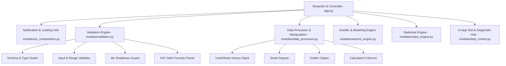

# ⚡ DataVortex — Akıllı Excel Veri Bilimi, Analitik, Validasyon & 1-Tık AutoML Platformu

[](https://www.python.org/)
[](https://streamlit.io/)
[](https://scikit-learn.org/)
[](https://plotly.com/)
[](https://pandas.pydata.org/)
[](https://pytest.org/)
[](LICENSE)

**DataVortex**, işletmeler, veri analistleri, araştırmacılar ve veri bilimciler için geliştirilmiş, uçtan uca modern ve interaktif bir **Excel Veri Bilimi, Güvenli Validasyon Mimarisi, Keşifçi Veri Analizi (EDA), 1-Tık Otomatik Makine Öğrenmesi (AutoML), Canlı Tahmin Simülatörü ve Sistem Test Merkezi** platformudur.

Kod yazmaya gerek kalmadan Excel (.xlsx, .xls, .xlsm) veya CSV tablolarınızı yükleyebilir; veri sağlığını anlık izleyebilir, veriyi temizleyip dönüştürebilir, işlem geçmişini (Undo/Redo) yönetebilir, güvenli formüllerle yeni sütunlar türetebilir, zengin 2D/3D interaktif grafiklerle görselleştirebilir, **1-tıkla tüm makine öğrenmesi modellerini veri setinize otomatik uyarlayıp eğitebilir**, en iyi şampiyon modeli seçebilir ve anlık girdi değerleriyle canlı tahminler üretebilirsiniz.

---

## 🏗️ Mimari ve Katman Yapısı



---

## 🚀 Öne Çıkan Özellikler

### 🛡️ 1. Kurumsal Validasyon & Güvenlik Mimarisi (`modules/validator.py`)
- **Şema & Enjeksiyon Koruması:** Sütun isimlerindeki XSS, SQL injection ve yasadışı karakterleri temizler, mükerrer ve adsız sütunları benzersizleştirir.
- **AST Tabanlı Güvenli Formül Motoru:** Python `eval`/`exec` açıklarını tamamen engelleyen, yalnızca güvenli matematiksel AST düğümlerine izin veren hesaplanan sütun türetme motoru.
- **Girdi & Tip Uyumu:** Doldurma sabitleri, aykırı değer sınırları ve tip dönüştürme veri kaybı oranlarını önceden hesaplayıp denetler.
- **ML Muhafızı (ML Guard):** Tarih sütunlarının hedef seçilmesini, tek sınıflı veya yetersiz verili modellerin eğitilmesini engeller; çoklu doğrusallığı ve sıfır varyanslı değişkenleri uyarır.

### 🧹 2. Veri Manipülasyonu & İşlem Geçmişi (Undo/Redo) (`modules/data_processor.py`)
- **İşlem Geçmişi (History Stack):** Yapılan her temizleme, doldurma, silme ve dönüştürme adımını etkilenen satır sayısı ve RAM değişimiyle kaydeder; tek tıkla geri alma (Undo) ve ileri alma (Redo) sağlar.
- **Eksik Değer Yönetimi:** Ortalama, Medyan, Mod, Sabit Değer, İleri/Geri Doldurma veya satır/sütun silme.
- **Aykırı Değer (Outlier) Budama:** IQR (1.5x) ve Z-Score (>3 std) yöntemleriyle sınır değerlere kırpma (Clip) veya silme.
- **Kural Tabanlı Gelişmiş Filtreleme:** Sayısal aralık, eşitlik, içerir, metin ve null kontrolleriyle çoklu filtreleme.

### 🤖 3. 1-Tık Akıllı AutoML & Model Liderlik Tablosu (`modules/automl_engine.py`)
- **Otomatik Görev Tespiti:** Sınıflandırma (Classification) veya Regresyon (Regression) görevini akıllıca belirler.
- **Geniş Model Benchmark Havuzu:** Random Forest, Hist Gradient Boosting, Extra Trees, Logistic Regression, Ridge, KNN, Decision Tree, Linear SVC/SVR, Gaussian Naive Bayes.
- **🏆 Şampiyon Model Seçimi:** F1-Score / R² skoruna göre en iyi modeli seçer ve özel altın vitrinde sunar.
- **Model Açıklanabilirliği:** Özellik önem düzeyleri, Confusion Matrix ve Gerçek vs. Tahmin saçılım analizi.

### 🔮 4. Canlı Tahmin Simülatörü & Toplu Tahmin
- **What-If Simülatörü:** Dinamik arayüz girdileriyle anlık sınıf/değer tahmini ve güven olasılık dağılımı (Confidence).
- **Toplu Tahmin (Batch):** Yeni yüklenen Excel/CSV dosyasına model tahminlerini ekleyip Excel/CSV formatında indirme.

### 🧪 5. Sistem & Veri Test Merkezi (`modules/test_runner.py`)
- **Arayüzden Canlı Pytest Koşucusu:** 26 birim/entegrasyon testini tek tıkla Streamlit arayüzünden çalıştırır ve canlı karne sunar.
- **20+ Kural Canlı Veri Stres Testi:** Aktif veri setini boyutluluk laneti, tekillik, eksiklik yoğunluğu ve anomali risklerine karşı puanlar (0-100).

### 📊 6. Keşifçi Veri Analizi (EDA) & İstatistik Motoru (`modules/stats_engine.py`)
- **İstatistikler:** Çarpıklık, basıklık, varyans, IQR ve dağılım metrikleri.
- **Hipotez Testleri:** Shapiro-Wilk, D'Agostino, İki Bağımsız Örneklem T-Testi, Tek Yönlü ANOVA, Ki-Kare.
- **Denetimsiz Öğrenme:** K-Means Kümeleme (Dirsek Yöntemi ile), Isolation Forest Anomali Tespiti ve 2D/3D PCA Boyut İndirgeme.

### 🎨 7. Modern UI, Yükleme Ekranları & Bildirim Sistemi (`modules/ui_components.py`)
- **Glassmorphism Tasarım Sistemi:** Canlı renk paleti, koyu tema uyumu, gradient başlıklar, KPI metrik kartları.
- **Yükleme Ekranları:** İşlem anında çalışan modern pulse spinner ve işlem durum bildirimleri.
- **Toast & Bildirim Hub'ı:** Tüm işlemlerde anlık başarı/uyarı/hata toast bildirimleri ve operasyon geri bildirim panelleri.

---

## 🛠️ Kurulum & Çalıştırma

### Gereksinimler
- Python 3.10 veya üzeri
- `pip` paket yöneticisi

### 1. Depoyu Klonlayın veya Proje Dizinine Gidin
```bash
cd DataVortex
```

### 2. Bağımlılıkları Yükleyin
```bash
pip install -r requirements.txt
```

### 3. Otomasyon Testlerini Çalıştırın (Pytest)
```bash
pytest tests/ -v
```

### 4. Uygulamayı Başlatın
```bash
streamlit run app.py
```

Tarayıcınızda otomatik olarak açılacaktır (varsayılan: `http://localhost:8501`).

---

## 📂 Proje Yapısı

```text
DataVortex/
│
├── app.py                      # DataVortex Ana UI Kontrolcüsü (8 Sekmeli)
├── requirements.txt            # Python Bağımlılıkları
├── README.md                   # Kapsamlı Proje Dokümantasyonu
│
├── modules/                    # Çekirdek Modüler Mimari
│   ├── __init__.py
│   ├── validator.py            # Şema, Girdi, Formül ve ML Validasyon Motoru
│   ├── data_processor.py       # Veri Temizleme, Manipülasyon & Undo/Redo Motoru
│   ├── automl_engine.py        # 1-Tık AutoML, Pipeline & Tahmin Motoru
│   ├── stats_engine.py         # Hipotez Testleri, K-Means, Isolation Forest, PCA
│   ├── ui_components.py        # CSS, Glassmorphism, Yükleme Ekranı & Toast Bildirimleri
│   └── test_runner.py          # Arayüz İçi Pytest & Stres Testi Yürütücüsü
│
└── tests/                      # Kapsamlı Otomasyon Test Paketi (26 Test)
    ├── __init__.py
    ├── conftest.py             # Test Fikstürleri & Sentetik Veri Setleri
    ├── test_validator.py       # Validasyon & Formül Testleri
    ├── test_data_processor.py  # Manipülasyon & Undo/Redo Testleri
    ├── test_automl_engine.py   # AutoML & Tahmin Testleri
    ├── test_stats_engine.py    # İstatistik & Algoritma Testleri
    └── test_schema_guard.py    # Şema Güvenliği & PyArrow Uyumluluk Testleri
```

---

## 📄 Lisans

Bu proje MIT lisansı altında sunulmaktadır.
